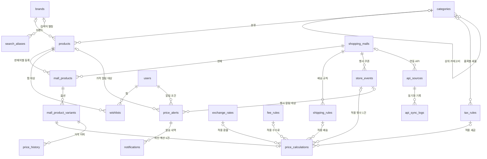
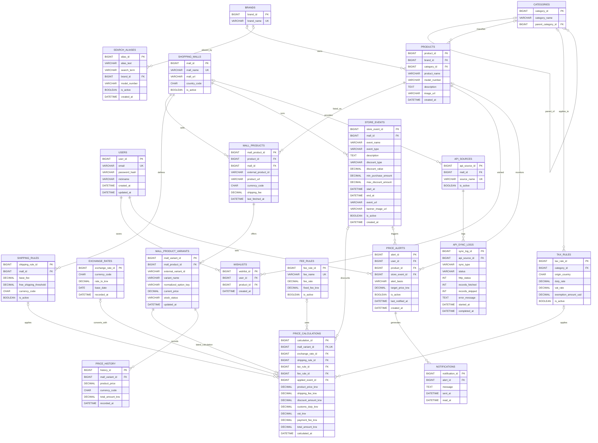

# GlobalPrice ERD

`02_create_tables.sql` 기준 · MySQL 8.0.16+ · 19개 테이블 · 외래 키 24개
`05_migration_002.sql` 적용 후 · 20개 테이블 · 외래 키 25개 (`search_aliases` 추가)
`06_migration_003.sql` 적용 후 · `mall_product_variants.normalized_option_key` 컬럼 추가

- 표기: `PK` 기본키, `FK` 외래키, `UK` 단일 컬럼 UNIQUE
- 여러 컬럼을 묶은 UNIQUE(복합 · 함수형)는 그림에 표시하지 않고 [5. UNIQUE 제약](#5-unique-제약) 표에 정리
- 관계선: `||` 정확히 1, `|o` 0 또는 1, `o{` 0 이상

## 1. 관계 개요

## 2. 영역별 테이블

5개 영역 17개 테이블 + 추가 제안 2개 = 19개

| 영역 | 수 | 테이블 | 저장하는 것 |
|---|---|---|---|
| 회원 · 상품 | 4 | USERS · BRANDS · CATEGORIES · PRODUCTS | 회원, 상품 기본정보 · 분류 |
| 쇼핑몰 · 판매 | 3 | SHOPPING_MALLS · MALL_PRODUCTS · MALL_PRODUCT_VARIANTS | 쇼핑몰별 가격 · 옵션 · 재고 |
| 구매 비용 계산 | 5 | EXCHANGE_RATES · SHIPPING_RULES · TAX_RULES · FEE_RULES · PRICE_CALCULATIONS | 환율 · 배송비 · 세금 · 수수료를 반영한 총액 |
| API 연동 관리 | 2 | API_SOURCES · API_SYNC_LOGS | API 정보, 수집 결과 · 오류 기록 |
| 사용자 편의 (선택) | 3 | WISHLISTS · PRICE_ALERTS · NOTIFICATIONS | 찜, 목표 가격, 알림 |
| 추가 제안 | +2 | PRICE_HISTORY · STORE_EVENTS | 가격 변동 그래프, 이번 달 행사 · 쿠폰 화면용 |
| 검색 (마이그레이션 002) | +1 | SEARCH_ALIASES | 한글 · 별칭 검색어 → API 검색어 · 브랜드 · 모델번호 |

설계 원칙

- **상품 ↔ 판매정보 분리** : 같은 상품(PRODUCTS)을 여러 판매처(MALL_PRODUCTS)에서 비교
- **규칙 테이블 + 계산 저장** : 환율 · 배송 · 세금 · 수수료 규칙으로 계산한 결과를 PRICE_CALCULATIONS 에 저장
- **API 수집 기록 분리** : 수집 상태 · 오류를 API_SYNC_LOGS 로 추적

## 3. 상세 (컬럼 포함)

## 4. 외래 키와 삭제 동작

| 자식 테이블.컬럼 | 부모 테이블 | ON DELETE |
|---|---|---|
| categories.parent_category_id | categories | SET NULL |
| products.brand_id | brands | SET NULL |
| products.category_id | categories | SET NULL |
| mall_products.product_id | products | CASCADE |
| mall_products.mall_id | shopping_malls | CASCADE |
| mall_product_variants.mall_product_id | mall_products | CASCADE |
| shipping_rules.mall_id | shopping_malls | CASCADE |
| tax_rules.category_id | categories | RESTRICT |
| store_events.mall_id | shopping_malls | CASCADE |
| price_calculations.mall_variant_id | mall_product_variants | CASCADE |
| price_calculations.exchange_rate_id | exchange_rates | SET NULL |
| price_calculations.shipping_rule_id | shipping_rules | SET NULL |
| price_calculations.tax_rule_id | tax_rules | SET NULL |
| price_calculations.fee_rule_id | fee_rules | SET NULL |
| price_calculations.applied_event_id | store_events | SET NULL |
| api_sources.mall_id | shopping_malls | SET NULL |
| api_sync_logs.api_source_id | api_sources | CASCADE |
| wishlists.user_id | users | CASCADE |
| wishlists.product_id | products | CASCADE |
| price_alerts.user_id | users | CASCADE |
| price_alerts.product_id | products | RESTRICT |
| price_alerts.store_event_id | store_events | RESTRICT |
| notifications.alert_id | price_alerts | CASCADE |
| price_history.mall_variant_id | mall_product_variants | CASCADE |
| search_aliases.brand_id | brands | CASCADE |

- `search_aliases.model_number`는 FK가 아니에요. `(brand_id, model_number)` 값으로 `products`(uq_product_brand_model)와 맞춰요.

## 5. UNIQUE 제약

| 테이블 | 제약 이름 | 대상 |
|---|---|---|
| users | email | email |
| brands | brand_name | brand_name |
| shopping_malls | mall_name | mall_name |
| fee_rules | fee_name | fee_name |
| api_sources | source_name | source_name |
| price_calculations | mall_variant_id | mall_variant_id (옵션당 계산 1건) |
| categories | uq_category_parent_name | IFNULL(parent_category_id, 0), category_name |
| products | uq_product_brand_model | brand_id, model_number |
| mall_products | uq_mall_external_product | mall_id, external_product_id |
| mall_product_variants | uq_variant_external | mall_product_id, external_variant_id |
| exchange_rates | uq_exchange_currency_date | currency_code, base_date |
| shipping_rules | uq_shipping_active_mall | IF(is_active, mall_id, NULL) |
| tax_rules | uq_tax_active_scope | IF(is_active, category_id:origin_country, NULL) |
| wishlists | uq_user_product | user_id, product_id |
| price_alerts | uq_alert_user_target | user_id, alert_basis, IFNULL(product_id, 0), IFNULL(store_event_id, 0) |
| search_aliases | uq_search_alias_target | alias_text, IFNULL(brand_id, 0), IFNULL(model_number, '') |

## 6. CHECK 제약 (18개)

| 테이블 | 제약 이름 | 조건 |
|---|---|---|
| mall_products | chk_mall_product_shipping | shipping_fee 가 NULL 이거나 0 이상 |
| mall_product_variants | chk_variant_price | current_price ≥ 0 |
| mall_product_variants | chk_variant_stock | stock_status ∈ IN_STOCK, OUT_OF_STOCK, UNKNOWN |
| exchange_rates | chk_exchange_rate | rate_to_krw > 0 |
| shipping_rules | chk_shipping_amount | base_fee ≥ 0, free_shipping_threshold 가 NULL 이거나 0 이상 |
| tax_rules | chk_tax_rate | duty_rate · vat_rate 0~1, exemption_amount_usd ≥ 0 |
| fee_rules | chk_fee_amount | fee_rate 0~1, fixed_fee_krw ≥ 0 |
| store_events | chk_event_period | end_at ≥ start_at |
| store_events | chk_event_type | event_type ∈ SALE, COUPON |
| store_events | chk_event_discount | 할인 유형 · 값은 둘 다 없거나 둘 다 있음(RATE/AMOUNT). COUPON 은 할인 필수, SALE 은 선택 |
| store_events | chk_event_discount_value | RATE 0 초과 1 이하, AMOUNT 0 초과, 최소구매 ≥ 0, 최대할인은 RATE 에만 (> 0) |
| price_calculations | chk_calculation_parts | 모든 금액 ≥ 0, 할인 ≤ 상품가 |
| price_calculations | chk_calculation_total | total = 상품가 + 배송비 − 할인 + 관세 + 부가세 + 수수료 |

## 7. 할인 정책

| 구분 | 규칙 |
|---|---|
| SALE | 정률(RATE) · 정액(AMOUNT) 모두 지원. 할인 정보 없는 SALE 도 허용 (가격에 이미 반영된 세일, 안내 · 알림용) |
| COUPON | 할인 정보 필수. 기간 · is_active · 최소 구매금액 조건을 충족할 때만 적용 |
| 중복 적용 | 불가. 계산 1건에 행사 1건 (`price_calculations.applied_event_id`), 할인액은 `discount_amount_krw` |
| api_sync_logs | chk_sync_status | status ∈ RUNNING, SUCCESS, PARTIAL, FAILED |
| api_sync_logs | chk_sync_counts | 건수 ≥ 0, completed_at ≥ started_at |
| price_alerts | chk_alert_target | 알림 유형별 product_id / store_event_id / target_price_krw 조합 |
| price_alerts | chk_alert_price | target_price_krw 가 NULL 이거나 0 초과 |
| price_history | chk_history_price | product_price ≥ 0, total_amount_krw 가 NULL 이거나 0 이상 |
| search_aliases | chk_search_alias_text | alias_text · search_term 이 빈 문자열이 아님 (마이그레이션 002) |
| search_aliases | chk_search_alias_model | model_number 가 NULL 이거나 빈 문자열이 아님 (마이그레이션 002) |
| mall_product_variants | chk_variant_option_key | normalized_option_key 가 NULL 이거나 빈 문자열이 아님 (마이그레이션 003) |
