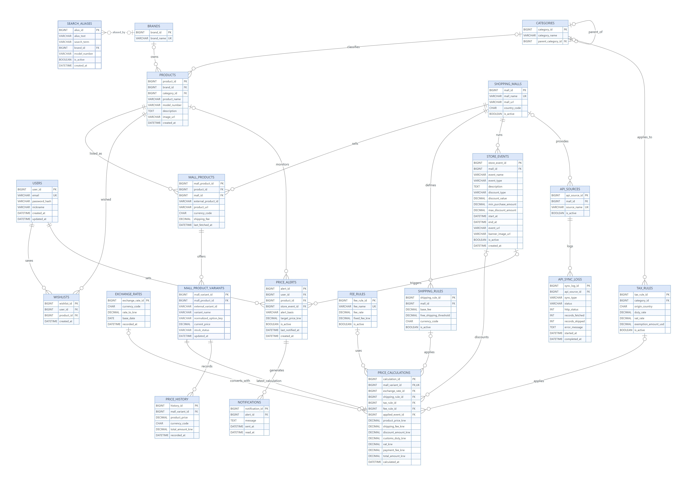

# 🌏 GlobalPrice

해외 쇼핑몰을 한 번에 검색해서, **배송비 · 할인 · 환율 · 관세 · 부가세 · 결제 수수료까지 더한 "한국 도착 예상 구매비용(원)"** 으로 정렬해 보여주는 해외직구 가격비교 웹서비스입니다.

<br>

## 프로젝트 소개

- 해외 직구는 상품 가격만 보면 싸 보여도 배송비, 관세, 부가세, 카드 수수료가 붙으면 실제 결제액이 크게 달라집니다.
- GlobalPrice는 검색할 때 eBay · Shopify · AliExpress · Etsy를 동시에 조회하고, 판매처별 **실제로 낼 돈**을 원화로 계산해 낮은 순으로 보여줍니다.
- 회원으로 가입하면 관심 상품을 저장하고, 목표 가격이나 할인 행사가 생기면 알림을 받을 수 있습니다.
- 대진대학교 캡스톤디자인 **TEAM SODA** 프로젝트입니다.

<br>

## 팀원 구성과 역할

<div align="center">

| **조경진** | **김명준** | **서승재** | **이석호** |
|  :------: |  :------: |  :------: |  :------: |
| [ <br/> @jin020709](https://github.com/jin020709) | [ <br/> @mjun7227](https://github.com/mjun7227) | [ <br/> @ratio-per-intellectum](https://github.com/ratio-per-intellectum) | [ <br/> @dtg024](https://github.com/dtg024) |
| 백엔드<br>가격 계산<br>회원 · 관심 상품 · 알림<br>발표 자료 | 쇼핑몰 API 연동<br>프론트엔드 | (담당 업무) | (담당 업무) |

</div>

<br>

## 1. 개발 환경

**Language** <div> </div>

**Framework** <div> </div>

**Database** <div></div>

**Tools** <div> </div>

**Collaboration** <div></div>

**외부 API** <div>    </div>

<br>

## 2. 개발 기간

- 전체 개발 기간 : (시작일) ~ (종료일)
- 요구사항 · 설계 : (기간)
- 기능 구현 : (기간)
- 테스트 · 발표 준비 : (기간)

<br>

## 3. 요구사항 명세 및 구조

<details>
  <summary>시스템 구조</summary>

```
브라우저 (HTML · CSS · JS)
   │  같은 서버에서 화면과 API를 함께 제공 (CORS 없음)
   ▼
Spring Boot 서버 (Java 25)
   ├─ 검색 : eBay · Shopify · AliExpress · Etsy 동시 조회 (가상 스레드)
   ├─ 가격 계산 : 환율 · 관세 · 부가세 · 수수료 반영
   ├─ 캐시 : 같은 검색어 10분 (Caffeine)
   ├─ 스케줄러 : 환율 수집 · 관심 상품 가격 갱신 · 행사 알림
   └─ 로그인 : HttpSession + BCrypt
   ▼
MySQL 8.0 (테이블 19개)
```

(그림 파일이 있으면 `docs/images/` 에 넣고 아래처럼 연결하세요.)


</details>

<br>

<details>
  <summary>예상 구매비용 계산 방법</summary>

| 단계 | 내용 |
|---|---|
| 1 | 과세가격 = 상품가 − 할인 + 배송비 |
| 2 | 면세 판정: 상품가(배송비 제외)가 미국발 $200, 그 외 $150 이하면 관세 · 부가세 0 |
| 3 | 관세 = 과세가격 × 관세율 (스마트폰 · 노트북 · 태블릿은 0%) |
| 4 | 부가세 = (과세가격 + 관세) × 10% |
| 5 | 세액 1만 원 미만이면 0원 (소액 면제) |
| 6 | 결제 수수료 1% |
| 7 | 원화 환산: 한국수출입은행 전신환매도율(tts) 적용 |

예) $799 + 배송비 $15, 환율 1,400원 → **약 ₩1,264,956**

**정확도 목표:** 계산 오차 0원 · 세금 ±1% · 실제 결제액 대비 예상 오차 ±3%

</details>

<br>

<details>
  <summary>ERD</summary>



</details>

<br>

## 4. 구현 기능

### [검색 · 가격 비교]
- 검색어를 입력하면 4개 쇼핑몰을 동시에 조회하고, 판매처별 **예상 구매비용이 낮은 순**으로 보여줍니다.
- 새 상품 위주로 보여주며, 한국으로 배송할 수 없는 상품은 제외합니다.
- 판매처 · 구매 국가 · 가격 · 무료배송 · 쿠폰 적용 필터와 정렬을 지원합니다.
- 같은 검색어는 10분 동안 캐시해서 두 번째부터 1초 안에 응답합니다. (처음 검색은 약 5초 이내)
- 한글 검색어는 DB 별칭 사전(`search_aliases`)으로 영문으로 바꿔 검색합니다. (예: 아이폰 → iphone, 케이스 → case)
- 일부 쇼핑몰 API가 실패해도 나머지 결과는 그대로 보여줍니다. (부분 응답)

| 검색 결과 |
| --- |
|  |

<br>

### [상품 상세 · 가격 이력]
- 판매처별 상품가, 배송비, 관세, 부가세, 수수료를 항목별로 보여줍니다.
- 기간별(1개월 · 3개월 · 6개월 · 1년) 최저 예상 구매비용 변화를 확인할 수 있습니다.
- 환율 기준 시각을 함께 표시하고, "예상 금액이며 환율 · 카드사에 따라 ±3% 달라질 수 있어요" 안내를 보여줍니다.

| 상품 상세 |
| --- |
|  |

<br>

### [회원가입 & 로그인]
- 이메일과 비밀번호로 회원가입을 하고, 비밀번호는 BCrypt로 암호화해 저장합니다.
- 로그인하면 세션이 유지되고, 로그인이 필요한 화면은 로그인 페이지로 안내합니다.

| 회원가입 · 로그인 |
| --- |
|  |

<br>

### [관심 상품 · 가격 알림]
- 상품을 관심 상품으로 저장하고, 목표 가격을 정해 두면 가격이 내려갔을 때 알림을 받습니다.
- 쇼핑몰의 할인 행사가 시작되면 알림을 받을 수 있습니다.
- 관심 상품 가격은 6시간마다 갱신하고, 행사 알림은 매일 오전 9시에 확인합니다.

| 마이페이지 |
| --- |
|  |

<br>

### [환율 자동 수집]
- 한국수출입은행 환율을 평일 11:30에 수집하고, 실패하면 15:00에 다시 시도합니다.
- 서버를 켜면 최근 영업일 환율을 자동으로 받아 저장합니다.

<br>

## 5. 쇼핑몰 연동 상태

| 쇼핑몰 | 상태 |
|---|---|
| eBay | 운영 키로 실제 검색 확인 (키 필요) |
| Shopify | 실제 검색 확인 (키 없이 동작) |
| AliExpress | 제휴 앱 키로 실제 검색 확인 (키 필요) |
| Etsy | 실제 검색 확인 (키 필요), 수공예 · 빈티지 상품 위주 |
| 한국수출입은행 환율 | 실제 키로 확인 (22개 통화) |

키가 없는 쇼핑몰은 오류 없이 검색 결과에 `skipped` 로만 표시됩니다.

<br>

## 6. 실행 방법

### 6-1. DB 준비
**MySQL 8.0.16 이상**이 필요합니다. (MariaDB는 지원하지 않습니다.)
`GlobalPrice_DB/GlobalPrice_DB` 폴더의 SQL을 **이 순서대로** 실행합니다.

```
01_create_database.sql
02_create_tables.sql
03_seed_data.sql        (한 번만 · 테스트 데이터. 06보다 먼저)
03_migration_001.sql    (환율 tts 컬럼 추가)
04_seed_dev.sql         (쇼핑몰 · API 소스 · 규칙 · 테스트 행사)
05_migration_002.sql    (검색어 별칭 테이블)
06_migration_003.sql    (옵션 정규화 컬럼)
07_migration_004.sql    (같은 상품 묶기 컬럼 · 필수: 없으면 검색이 실패해요)
08_migration_005.sql    (한영 검색어 별칭 · 필수: 없으면 한글 검색어가 번역되지 않아요)
```

마이그레이션은 이미 적용돼 있으면 건너뛰므로 여러 번 실행해도 안전합니다. 시연용 가짜 가격 이력이 필요하면 상품을 몇 번 검색한 뒤 `90_demo_price_history.sql`을 실행합니다 (운영 DB에는 넣지 마세요).

### 6-2. 환경 변수 등록
API 키와 DB 비밀번호는 **저장소에 올리지 않고 환경 변수로만** 받습니다. (키는 팀 채팅으로 따로 받으세요.)

| 환경 변수 | 설명 | 없으면 |
|---|---|---|
| `DB_USER` · `DB_PASSWORD` | MySQL 계정 (기본 `root` / 빈 비밀번호) | 기본값 사용 |
| `EBAY_CLIENT_ID` · `EBAY_CLIENT_SECRET` | eBay 운영 App ID · Cert ID | eBay 검색 안 함 |
| `EBAY_SANDBOX` | 실제 검색은 `false` | 기본 `true` → 결과 0건 |
| `ALI_APP_KEY` · `ALI_APP_SECRET` | AliExpress 제휴 앱 키 | AliExpress 검색 안 함 |
| `ETSY_API_KEY` | `keystring:shared_secret` 형식 | Etsy 검색 안 함 |
| `KOREAEXIM_KEY` | 한국수출입은행 환율 인증키 | 환율 수집 안 함 |

Windows PowerShell에서 한 번만 등록하면 재부팅 후에도 유지됩니다. 값은 변수마다 한 줄씩 넣습니다.

```powershell
[Environment]::SetEnvironmentVariable('DB_PASSWORD', '값', 'User')
```

등록한 뒤에는 **열려 있던 터미널과 IDE를 다시 켜야** 새 값이 적용됩니다.

### 6-3. 서버 실행
```powershell
cd globalprice-backend
.\gradlew.bat bootRun          # Windows PowerShell
./gradlew bootRun              # Mac · Linux
```

Eclipse에서는 `File → Import → Gradle → Existing Gradle Project`로 `globalprice-backend`를 가져온 뒤, **Gradle Tasks 창의 `application → bootRun`** 으로 실행합니다. (화면 파일은 Gradle 빌드가 `GlobalPrice_frontend`에서 복사하므로, `Run As → Java Application`으로 바로 실행하면 화면이 안 나올 수 있어요.)

### 6-4. 접속
브라우저에서 http://localhost:8080 을 엽니다. 화면과 API를 같은 서버에서 제공합니다.

<br>

## 7. API 요약

| 메서드 · 주소 | 설명 |
|---|---|
| GET `/api/products?q=` | 상품 검색 (판매처 · 국가 · 가격 · 정렬 · 페이지 옵션) |
| GET `/api/products/{id}` | 상품 상세 |
| GET `/api/products/{id}/price-history` | 기간별 가격 이력 |
| GET `/api/exchange-rates` · `/api/home` | 환율 · 홈 화면 |
| POST `/api/auth/signup` · `login` · `logout` | 회원가입 · 로그인 · 로그아웃 |
| GET `/api/auth/me` | 내 정보 |
| GET · POST · DELETE `/api/wishlist` | 관심 상품 |
| GET · POST · DELETE `/api/alerts` | 가격 알림 |
| GET · PATCH `/api/notifications` | 받은 알림 · 읽음 처리 |
| GET `/api/health` | 서버 상태 확인 |

오류 응답은 `{ status, code, message, timestamp }` 형식입니다. 필드 단위 명세는 [BACKEND_SPEC.md](BACKEND_SPEC.md) 6장에 있습니다.

<br>

## 8. 폴더 구조

```
globalprice-main
├─ globalprice-backend/        Spring Boot 백엔드 (화면도 함께 제공)
│   └─ src/main/java/com/teamsoda/globalprice
│        ├─ config · exception · common
│        ├─ auth · wishlist · alert
│        ├─ source (ebay · shopify · aliexpress · etsy)
│        ├─ rate · pricing · catalog · search
│        ├─ scheduler
│        └─ web
├─ GlobalPrice_frontend/       프론트엔드 원본 (HTML · CSS · JS)
├─ GlobalPrice_DB/             MySQL 스크립트 · ERD
├─ BACKEND_SPEC.md             명세서 (백엔드 · 외부 API · 가격 계산 · 프론트 API 필드, 유일한 기준 문서)
└─ README.md
```

> 화면 파일은 `GlobalPrice_frontend/static/` 한 곳에만 있습니다. 서버를 빌드할 때 Gradle이 백엔드로 복사하면서 `js/config.js`의 `USE_MOCK`만 `false`로 바꿔요. 프론트를 고친 뒤 따로 복사할 필요 없이 서버만 다시 켜면 됩니다.

<br>

## 9. 알려진 한계 · 개선 예정

- 같은 상품 묶기는 아이폰 · 갤럭시 · 픽셀 · 맥북 · 아이패드는 모델 + 용량 기준, 그 밖의 상품은 모델코드나 상품명이 같을 때만 묶습니다. 이름이 조금만 달라도 따로 나올 수 있습니다.
- 케이스 · 필름 같은 **액세서리와 비정상적으로 낮은 가격**은 제외 키워드와 이상 가격 판정으로 거르지만, 이름에 표시가 없거나 판매처가 1곳뿐인 상품은 일부 섞일 수 있습니다.
- 같은 날 여러 상품을 사는 **합산 과세**는 계산하지 않습니다. (상품 1개 기준 예상 금액)
- 통관 시 확정 세액을 보장하지 않으며, 화면의 금액은 **예상 금액**입니다.

<br>

## 10. 프로젝트 후기

### 🌏 조경진

프로젝트 후기 :

<br>

### 🌏 김명준

프로젝트 후기 :

<br>

### 🌏 서승재

프로젝트 후기 :

<br>

### 🌏 이석호

프로젝트 후기 :

<br>


프로젝트 후기 :
